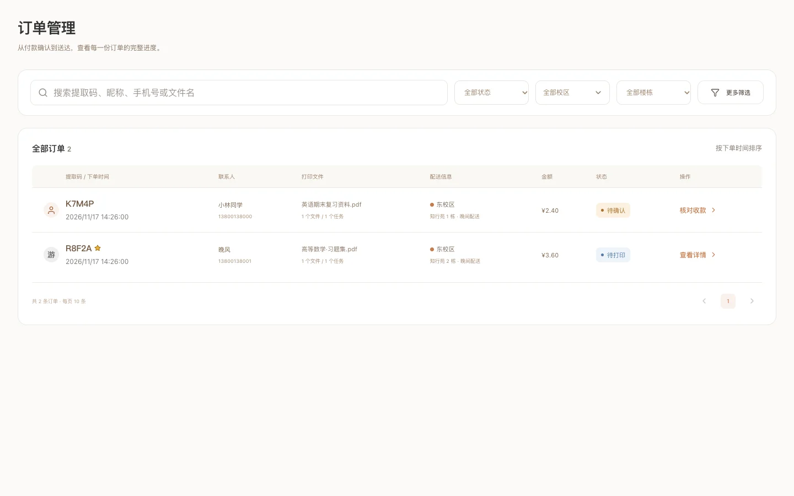
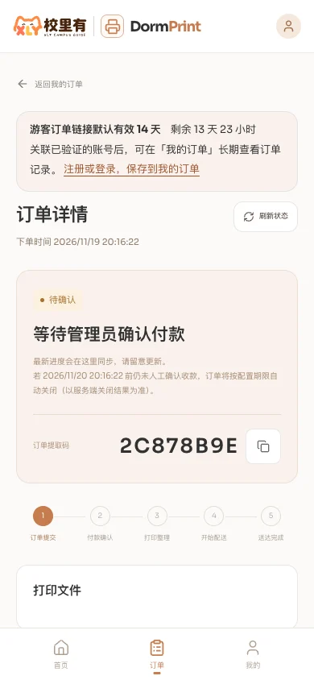
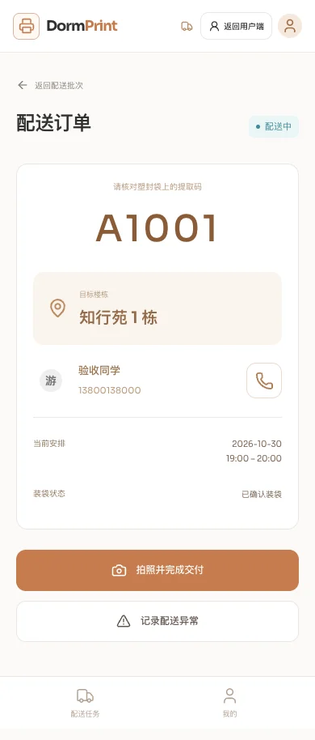
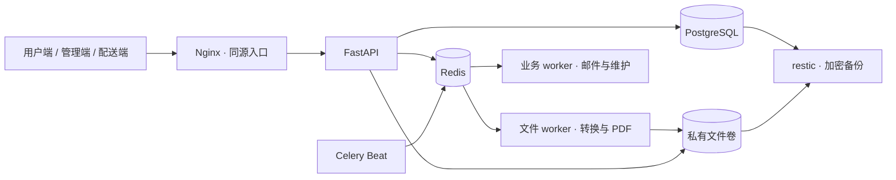

<p align="center">
  
</p>

<h1 align="center">DormPrint · 宿舍打印</h1>

<p align="center">从在线上传到楼栋交付，让校园打印成为简单的事。</p>

<p align="center">
  <a href="LICENSE"></a>
  
  
  
  
</p>

<p align="center">
  <a href="#产品预览">产品预览</a> ·
  <a href="#核心功能">核心功能</a> ·
  <a href="#快速开始">快速开始</a> ·
  <a href="#生产部署">生产部署</a> ·
  <a href="#本地开发">本地开发</a> ·
  <a href="#文档导航">文档导航</a>
</p>

DormPrint 是面向校园打印服务的自托管系统，将**用户下单、后台生产与配送履约**放在同一套应用中。学生上传文件、确认最终 PDF 并预约配送；管理员核对线下收款、组织打印与装袋；配送员按校区、时段和楼栋完成交付。

一份订单可以包含多个文件和不同打印设置，以提取码贯穿整个流程。收款与实际打印结果由运营人员确认，系统保留对应的订单、任务及交付记录。

## 产品预览

以下为当前界面的演示／验收数据截图，不包含真实用户资料。生产初始化不会写入这些示例订单或价目。

**用户端 · 服务首页**


**管理端 · 订单列表**



**移动端 · 游客订单与配送交付**

<p align="center">
  
  
</p>

## 核心功能

| 工作区 | 能做什么 |
| --- | --- |
| 用户端 | 文档／照片上传、断点续传、转换与最终 PDF 预览、打印参数与报价、校区／楼栋／配送时段预约、订单查询与售后 |
| 管理端 | 人工收款与零元结算、打印／装订／装袋任务、订单识别页、批次调度、客户管理、优惠与员工权限、邮件配置 |
| 配送端 | 查看分配的批次、按楼栋交付、拨号联系、照片与定位凭证、同楼栋共照批量送达、配送异常与定位例外 |
| 经营管理 | 追加费用及异议、退款与重做、配送工资核算与发放、纸张／墨水／其他采购支出、月度及累计收支 |

- **一个账号，多个工作区**：普通账号统一登录，管理员按账号授予管理或配送权限；一个 PWA 按权限进入对应工作区。
- **账号订单与游客订单**：账号订单按当前归属访问；游客每单仅有一个有效访问链接，默认 14 天，界面显示倒计时。管理员可关闭或重置为 1–14 天，重置使旧链接失效。游客可在满足身份校验后明确关联账号，后续从「我的订单」查看。
- **一致的身份标识**：灰色「游」与账号小人按当前订单归属切换。后台有权限时可进入客户详情；配送端只显示图标。
- **可核对的文件输出**：支持 PDF、Word、Excel、PowerPoint 及常见图片／HEIC；通过 LibreOffice、PyMuPDF 等处理，确认最终 PDF 后进入生产。订单识别页独立统计进度，预览支持首页／末页跳转。
- **私有文件与后台作业**：原件、最终 PDF、交付照片和导出通过授权接口访问；文件转换与业务任务分别使用 Celery 队列，备份使用 restic 加密。

## 快速开始

### 用 Docker 在本机运行

需要 **Git、已启动的 Docker Engine／Docker Desktop，以及 Docker Compose ≥ 2.24.4**。这一方式在容器内构建前后端，无需在本机安装 Node、Python 或 LibreOffice。

```bash
git clone https://github.com/KHIIHarry/dormitory-print.git
cd dormitory-print
bash deploy/local.sh up
```

打开 **[http://localhost:8080](http://localhost:8080)**。首次启动会构建镜像、等待数据库与 Redis、执行迁移并检查运行依赖。

初始化管理员，邮箱请换成你实际控制并已核验的地址，密码按交互提示设置：

```bash
bash deploy/local.sh init-admin --username admin --email owner@example.com
```

从 `/u/account` 登录后进入管理工作区。没有默认管理员密码；新注册所需的 SMTP 要在部署及后台配置完成后才能使用，已有账号和游客业务可独立运行。

| 入口 | 地址 | 说明 |
| --- | --- | --- |
| 用户首页 | `/u/` | 上传、报价、预约与订单查询 |
| 账号中心 | `/u/account` | 统一登录、个人信息与获授权的工作区入口 |
| 管理工作区 | `/manage/` | 需要对应管理权限；路径可通过前端配置调整 |
| 配送工作区 | `/courier/` | 需要配送工作区权限，仅查看允许访问的任务 |

常用本机命令：

```bash
bash deploy/local.sh ps
bash deploy/local.sh logs -f api file-worker business-worker
bash deploy/local.sh doctor
bash deploy/local.sh down
```

`down` 保留数据卷。再次执行 `up` 可启动或在更新代码后重建。本机凭据保存在已忽略的 `deploy/.env.local`，数据使用独立的 `dormprint-local` 命名卷；保留数据时也要保留原凭据和主密钥。本机模式仅监听回环地址、使用 HTTP，备份服务默认不启动。

## 技术架构

| 层次 | 技术 |
| --- | --- |
| 前端 | React 19、TypeScript、Vite、React Router、TanStack Query、PDF.js、PWA |
| API | Python 3.12、FastAPI、Pydantic、SQLAlchemy、Alembic |
| 数据与队列 | PostgreSQL 16、Redis 7、Celery |
| 文件处理 | LibreOffice、PyMuPDF、Ghostscript、Pillow／HEIF、中文字体 |
| 部署与备份 | Docker Compose、Nginx、restic |



API 不负责执行文件转换，文件 worker 无外网出口。Nginx 只提供前端静态产物并反代 API，不公开私有文件目录；数据库、Redis 和 API 的端口不对公网发布。

## 生产部署

下面是**首次部署**的最小流程。已有数据的环境请使用后面的升级说明；TLS、备份恢复和代理信任配置以 [完整部署手册](docs/DEPLOYMENT.md) 为准。

### 1. 准备环境与配置

准备 Linux 主机、Docker Compose、Node.js ≥ 20.19，以及指向该主机的域名和 HTTPS 入口。推荐由主机 Caddy／Nginx 或负载均衡终止 TLS，反代到本机 `127.0.0.1:8080`。

```bash
git clone https://github.com/KHIIHarry/dormitory-print.git
cd dormitory-print
cp deploy/.env.example deploy/.env
chmod 600 deploy/.env
```

编辑 `deploy/.env`，至少完成以下配置：

| 变量 | 配置要求 |
| --- | --- |
| `POSTGRES_PASSWORD`、`REDIS_PASSWORD` | 各自使用强随机值，建议 URL 安全字符 |
| `DORMPRINT_SECRET_KEY` | 固定、至少 32 字符的随机主密钥；单独安全保存，升级时保留 |
| `DORMPRINT_PUBLIC_ORIGIN` | 浏览器实际使用的完整 HTTPS 源，如 `https://print.example.com` |
| `DORMPRINT_PUBLIC_HOST` | 对应域名，如 `print.example.com` |
| `DORMPRINT_INITIAL_ADMIN_USERNAME` | 首次管理员用户名 |
| `DORMPRINT_INITIAL_ADMIN_EMAIL` | 部署负责人已核验的真实账号邮箱 |
| `DORMPRINT_MAIL_ALLOWED_HOSTS` | 实际 SMTP 主机白名单；连接参数及发信账号在后台配置 |
| `RESTIC_REPOSITORY`、`RESTIC_PASSWORD` 等 | 加密备份仓库及凭据，按备份手册配置 |

可用 `openssl rand -hex 32` 生成随机值。域名和邮箱示例需替换；真实环境文件、私钥和凭据不要提交到仓库。未配置备份目标时，备份服务会报告 `BACKUP_UNAVAILABLE`。

### 2. 构建并初始化

在仓库根目录、同一个 Bash 会话执行：

```bash
# 正式前端产物；不要使用 build:demo
npm ci --legacy-peer-deps
npm run build

# 缩短后续 Compose 命令
dc() { docker compose -f deploy/compose.yaml --env-file deploy/.env "$@"; }

dc config --quiet
dc build api file-worker business-worker beat migrate init-admin doctor backup
dc up -d --wait postgres redis
dc run --rm --no-deps volume-init
dc run --rm --no-deps migrate
dc run --rm --no-deps init-admin
dc run --rm --no-deps doctor
dc up -d api file-worker business-worker beat proxy backup
```

`init-admin` 交互设置密码。Nginx 只读挂载 `dist/`；部署时必须实际发布构建产物。随后配置外层 HTTPS 反代；仓库也提供 [TLS overlay](deploy/compose.tls.yaml)，证书和公网入口由部署者配置。

### 3. 检查与业务初始化

```bash
curl -fsS http://127.0.0.1:8080/api/v1/health/live
curl -fsS http://127.0.0.1:8080/api/v1/health/ready
dc ps
dc logs -f api file-worker business-worker
```

从正式 HTTPS 域名访问并登录，配置价目、校区、楼栋、配送时段、联系方式及 SMTP。通过一笔测试订单核对上传、转换、人工收款、生产、装袋和交付流程，并验证备份恢复。

摄像头、定位、PWA、实体出纸和真实邮件投递需要在目标设备与正式环境验收，不能以健康检查代替。

### 已有环境升级

先确认工作区无未处理修改，再拉取：

```bash
git pull --ff-only origin main
```

发布按以下顺序进行：**核对增量说明 → 维护窗口停写 → 创建并验证备份点 → 构建匹配版本的前后端 → 执行迁移 → 同步启动服务 → 验证并恢复入口**。保留原环境文件、数据卷和 `DORMPRINT_SECRET_KEY`。

- 游客订单与账号归属升级涉及历史链接、会话及订单回填，必须遵循 [升级说明](docs/incremental/2026-11-18-guest-order-access.md)。最新配送身份图标需要 API 与前端同步更新。
- `ce72aa117014` 降级会作废游客链接与会话；存在新独立账号归属时会拒绝降级。上线后优先前向修复，恢复方案见 [备份与恢复](docs/BACKUP-RESTORE.md)。
- 升级后让已打开的页面／PWA 刷新到新版本。`git push` 本身不会自动部署生产服务。

## 本地开发

需要 Node.js ≥ 20.19、Python 3.12、独立的开发 PostgreSQL／Redis，以及可用的 LibreOffice、Ghostscript 和中文字体。

**前端**

```bash
npm ci --legacy-peer-deps
cp .env.example .env.local
npm run dev
```

访问 `http://localhost:5173`。Vite 默认把 `/api/v1` 代理到 `http://127.0.0.1:8000`，可通过 `.env.local` 中的 `DORMPRINT_DEV_API_TARGET` 调整。

**后端**

```bash
cd backend
python3.12 -m venv .venv
.venv/bin/pip install -r requirements.txt
cp .env.example .env.local
```

编辑 `backend/.env.local`：环境改为 `development`、源改为 `http://localhost:5173`、`DORMPRINT_SECURE_COOKIES=false`；数据库／Redis URL 指向开发实例，存储路径改为 `.data`，主密钥使用固定随机值，Office／Ghostscript 路径按本机安装位置填写。示例文件默认是生产配置，需要修改后再运行。

```bash
# 在 backend/ 中执行
.venv/bin/python -m app.cli migrate
.venv/bin/python -m app.cli init-admin --username admin --email owner@example.com
.venv/bin/uvicorn app.main:create_app --factory --host 127.0.0.1 --port 8000
```

另开终端，在 `backend/` 分别运行 worker 和调度器：

```bash
.venv/bin/celery -A app.jobs:celery_app worker -Q files,business --concurrency=2
.venv/bin/celery -A app.jobs:celery_app beat
```

本机合并队列仅用于联调；生产使用 Compose 中独立的文件与业务 worker。仅浏览前端演示可执行 `npm run dev -- --mode demo`，使用虚构数据；正式构建使用 `npm run build`，真实 API 模式不会自动回退到演示。

## 测试与契约

移动 UI 配置中的 Chromium 项目使用本机 Google Chrome，请先安装 Chrome；以下命令另行安装 Playwright 的浏览器资源。

```bash
npm test
npm run build
npm run test:e2e:install
npm run test:e2e:install-webkit
npm run test:e2e:mobile-ui
```

移动布局回归覆盖 Chromium／WebKit 和 320、375、390、430、768、1440 px；桌面浏览器模拟不等于 iPhone Safari、微信或已安装 PWA 的真机验收。

后端测试只使用独立测试数据库。默认连接 `127.0.0.1:55432` 的 DormPrint 测试库，也可通过 `DORMPRINT_TEST_DATABASE_URL` 指定；测试会创建并清理隔离 schema，不能指向业务数据库。

```bash
cd backend
.venv/bin/pytest -q
```

修改接口后，在仓库根目录生成契约；以 FastAPI OpenAPI 为源，不手改生成文件：

```bash
npm run contract:generate
```

本机 Docker 配置回归：`node --test tests/deploy/local-docker.test.mjs`。已启动本机栈后，可执行 `node --test tests/deploy/local-docker.smoke.mjs` 检查真实入口。

## 项目结构

```text
src/
├── customer/       # 用户端：上传、订单与账号
├── admin/          # 管理端：订单、生产与调度
├── courier/        # 配送任务与交付
├── components/     # 共用界面组件
├── growth/         # 身份、客户、优惠与演示适配
└── lib/            # 状态、类型、接口与文件工具
backend/
├── app/            # FastAPI 业务模块与 Celery 作业
├── alembic/        # 数据库迁移
└── tests/          # PostgreSQL 集成与浏览器验收
deploy/             # Docker、Nginx、备份与启动脚本
docs/               # 部署、业务说明与产品截图
tests/              # 前端单元、浏览器与部署测试
```

## 文档导航

| 文档 | 内容 |
| --- | --- |
| [生产部署](docs/DEPLOYMENT.md) | 环境变量、镜像、初始化、TLS、可信代理与运维 |
| [备份与恢复](docs/BACKUP-RESTORE.md) | restic、保留策略、锁恢复、主密钥与恢复演练 |
| [账号归属与游客链接升级](docs/incremental/2026-11-18-guest-order-access.md) | 14 天访问、关联账号、迁移与回退限制、三端身份图标 |
| [校区配送升级](docs/incremental/2026-11-03-campus-delivery.md) | 校区独立时段、历史容量与引用迁移 |
| [V1 业务范围](docs/superpowers/specs/2026-10-30-dormprint-v1-scope.md) | 已确认业务规则与功能边界 |
| [API 契约](docs/openapi.yaml) | 由实际 FastAPI 应用生成的 OpenAPI |
| [界面设计](DESIGN.md) · [移动端规范](docs/UIUX-移动端布局规范.md) | 字体、间距、触控区域与浏览器验收要求 |

## 参与贡献

欢迎通过 [Issues](https://github.com/KHIIHarry/dormitory-print/issues) 报告问题或提出建议，通过 Pull Request 提交修改。问题反馈请附复现步骤、版本、浏览器及视口；界面修改遵循仓库 `AGENTS.md`、设计与移动端规范，并运行对应测试。请勿提交真实账号、订单资料、上传文件或环境密钥。

## 许可证

项目采用 [Apache License 2.0](LICENSE)。
